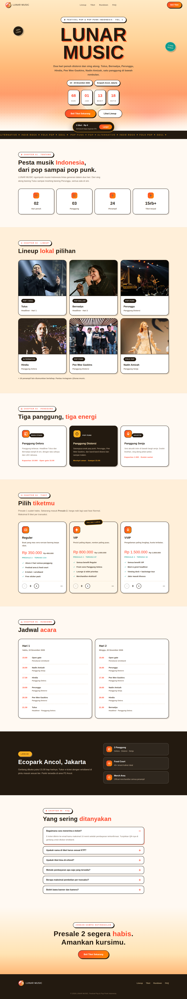

# Lunar Music — Festival Pop & Pop Punk Indonesia

Landing page festival musik bertema isekai/fantasy, terinspirasi key visual Re:ZERO Season 4 (langit senja ungu-magenta-amber).

## Fitur

- Hero langit senja dengan starfield animasi, bulan, dan gradient title
- Countdown real-time ke 19 Desember 2026
- Marquee genre berjalan
- Lineup 6 penampil (kartu hover glow)
- 3 panggung ("realm") dengan layout zig-zag
- 3 tier tiket dengan modal pemesanan (pilih jumlah, total otomatis, salin detail pesanan)
- FAQ accordion, venue, final CTA
- Logo custom: torii gate + bulan sabit + not balok (transparan)
- Favicon set: ICO + PNG 32 + Apple touch icon
- Responsif penuh + animasi scroll-reveal

## Tech

React 19 + Vite. Tanpa dependency UI tambahan.

```bash
npm install
npm run dev
npm run build
```

## Screenshot



